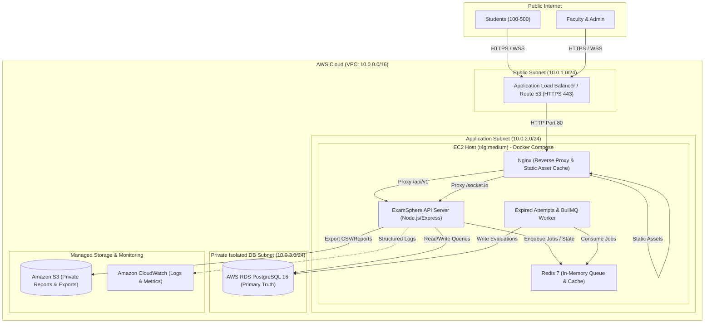

# ExamSphere – AWS Production Deployment Guide
## Right-Sized Cloud Architecture for Department-Level Examination Pilot (100–500 Students)

> **Important Deployment Notice:**  
> This documentation specifies the exact, right-sized cloud architecture, security boundaries, and step-by-step instructions for deploying ExamSphere to Amazon Web Services (AWS). No cloud resources have been provisioned or billed without explicit user authorization.

---

## 1. High-Level Architecture Overview

For a college department examination platform serving **100–500 concurrent students** and multiple faculty members, enterprise Kubernetes clusters (EKS) or complex microservice meshes are unnecessarily expensive and brittle.

Instead, ExamSphere utilizes a **cost-effective, highly reliable containerized topology**:
- **Ingress & Security**: Route 53 DNS + AWS Certificate Manager (ACM) + Application Load Balancer (ALB) or Nginx with Let's Encrypt handling TLS termination.
- **Compute**: A single **AWS EC2 instance (`t4g.medium` / `t3.medium`)** running Docker Compose with internal networks isolating the Node.js API, background BullMQ workers, and Redis cache.
- **Data Persistence**: **AWS RDS PostgreSQL (`db.t4g.micro` or `db.t4g.small`)** in a private DB subnet with automated daily backups and point-in-time recovery (PITR).
- **Blob & Report Storage**: **Amazon S3** for secure, private storage of exported grade reports, CSV archives, and proctoring telemetry snapshots.
- **Observability**: **Amazon CloudWatch** for container log aggregation and CPU/Memory utilization alarms.

### Architecture Diagram



---

## 2. Component Responsibilities

| Component | Technology | Responsibility |
| :--- | :--- | :--- |
| **Edge & DNS** | Route 53 & ACM | Custom domain resolution (`exams.college.edu`) and free SSL/TLS certificate renewal. |
| **Ingress Proxy** | Nginx Alpine Container | Serves bundled Vite React SPA assets; terminates client connections; handles Gzip compression and long-term caching for `/assets/`; reverse proxies REST APIs (`/api/v1`) and WebSockets (`/socket.io`). |
| **API Application** | Node.js 20 / Express | Runs modular monolith services: Auth (JWT/RBAC), Question Bank, Exam Scheduling, Attempt Execution Engine, Real-Time Proctoring, and Health Probes. |
| **Background Processing**| BullMQ + Node.js Worker | Handles asynchronous background evaluations, retry backoff policies, and recurring scans for expired attempts (`expiredAttemptsWorker`). |
| **Transient Cache** | Redis 7 Alpine Container | Provides low-latency session counters, rate-limiting store, Socket.IO adapter sync, and BullMQ message broker. |
| **Relational Database** | AWS RDS PostgreSQL 16 | Durable primary source of truth for all users, questions, exams, assignments, attempts, answers, and results. |
| **Object Storage** | Amazon S3 | Private bucket with server-side encryption (AES-256) for student batch imports, faculty exam analytics CSV exports, and audit receipts. |

---

## 3. Network Topology & Security Groups

### VPC Configuration
- **VPC CIDR**: `10.0.0.0/16`
- **Public Subnets**: `10.0.1.0/24`, `10.0.2.0/24` (Multi-AZ for ALB)
- **Private App Subnet**: `10.0.10.0/24` (EC2 Docker host)
- **Private DB Subnet Group**: `10.0.20.0/24`, `10.0.21.0/24` (RDS PostgreSQL)

### Security Group Ingress / Egress Matrix

| Security Group | Ingress Rules | Egress Rules | Purpose |
| :--- | :--- | :--- | :--- |
| **`sg-alb`** | Port 80 (HTTP) from `0.0.0.0/0`<br>Port 443 (HTTPS) from `0.0.0.0/0` | All traffic to `sg-ec2` | Public internet entry point. |
| **`sg-ec2`** | Port 80 / 443 from `sg-alb`<br>Port 22 (SSH) from College Admin Bastion / VPN ONLY | Port 5432 to `sg-rds`<br>Port 443 to AWS Services (S3, CloudWatch) | Docker Compose host instance. |
| **`sg-rds`** | Port 5432 (Postgres) from `sg-ec2` ONLY | None | Strictly isolated relational database. |

> [!CAUTION]
> **Never open Port 5432 or Port 6379 to `0.0.0.0/0`!**  
> PostgreSQL and Redis must only accept traffic originating from inside the VPC security group (`sg-ec2`).

---

## 4. Estimated Operational Cost Categories

> *Note: The figures below are estimated baseline projections based on standard AWS US East (N. Virginia) on-demand pricing and may vary with usage, AWS Free Tier eligibility, or region.*

| Category | AWS Service | Specification | Estimated Monthly Cost |
| :--- | :--- | :--- | :--- |
| **Compute** | EC2 Instance | `t4g.medium` (2 vCPU, 4GB RAM, ARM Graviton2) | ~$24.50 / month |
| **Compute Storage**| EBS gp3 Volume | 30 GB SSD | ~$2.40 / month |
| **Database** | RDS PostgreSQL | `db.t4g.micro` (2 vCPU, 1GB RAM) or `db.t4g.small` | ~$15.00 – $29.00 / month |
| **Database Storage**| RDS gp3 Storage | 20 GB Allocated (Auto-scaling up to 100 GB) | ~$2.30 / month |
| **Object Storage**| Amazon S3 | Standard Storage (~5 GB reports & archives) | ~$0.15 / month |
| **Networking & DNS**| Route 53 + ACM | 1 Hosted Zone + Free SSL Certificates | ~$0.50 / month |
| **Monitoring** | Amazon CloudWatch | Basic metrics & 5 GB Log ingestion | ~$2.50 / month |
| **Total Estimated Cost**| | **Complete Production Environment** | **~$47.35 – $61.35 / month** |

---

## 5. Step-by-Step Production Deployment Procedure

### Step 1: Provision Infrastructure via AWS Console or CLI
1. Launch an EC2 instance (`t4g.medium`, Ubuntu 24.04 LTS) in your public/private VPC subnet with `sg-ec2`.
2. Provision an AWS RDS PostgreSQL 16 database instance in the private DB subnet group with `sg-rds`.
3. Create an Amazon S3 bucket (e.g. `examsphere-college-pilot-storage`) with Block Public Access enabled.

### Step 2: Configure Server Host Environment
SSH into the EC2 instance and install Docker and Docker Compose plugin:
```bash
sudo apt-get update && sudo apt-get install -y docker.io docker-compose-v2 git
sudo usermod -aG docker ubuntu
```

### Step 3: Clone Codebase and Configure Environment
```bash
git clone https://github.com/your-org/LogicHub.git /opt/examsphere
cd /opt/examsphere

# Copy production environment template
cp .env.example .env

# Generate high-entropy secrets
openssl rand -hex 32  # Use for JWT_SECRET
openssl rand -hex 32  # Use for REFRESH_TOKEN_SECRET
```
Edit `/opt/examsphere/.env` with your RDS endpoint, credentials, and production domain URL.

### Step 4: Run Safe Production Database Migrations
```bash
cd /opt/examsphere/server
# Never use 'prisma migrate reset' in production!
npx prisma migrate deploy
```

### Step 5: Start Dockerized Production Stack
```bash
cd /opt/examsphere
docker compose -f docker-compose.prod.yml up -d --build
```

### Step 6: Verify Container Health Status
```bash
docker compose -f docker-compose.prod.yml ps
curl -i http://localhost/health
curl -i http://localhost/health/ready
```

---

## 6. Disaster Recovery & Rollback Strategy

1. **Automated Point-in-Time Recovery (PITR)**: AWS RDS retains 7 to 35 days of automated snapshots. Any accidental corruption can be restored to any given second.
2. **Pre-Migration Snapshot**: Before running any Prisma schema migrations, execute:
   ```bash
   node /opt/examsphere/server/src/scripts/backupDatabase.js
   ```
3. **Rollback Consideration**:
   - If a deployment introduces a breaking bug, roll back the Git commit and run:
     ```bash
     docker compose -f docker-compose.prod.yml up -d --build
     ```
   - For database schema rollbacks, revert the Prisma migration file and apply the down-migration SQL script generated during pre-deployment planning.
