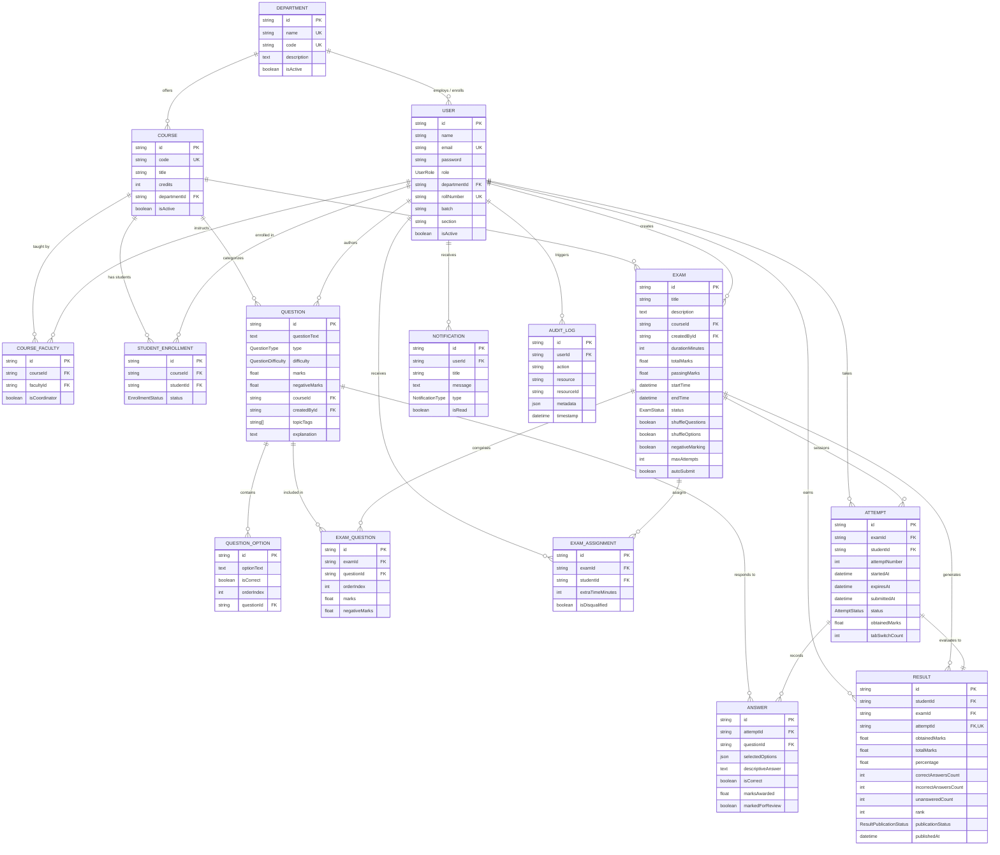

# ExamSphere – Database Architecture & Schema Design

## 1. Overview

**ExamSphere** uses **PostgreSQL 16** managed via **Prisma ORM** as its primary relational datastore. The schema is designed for an enterprise, cloud-native online examination and automated assessment platform.

### Core Architectural Pillars
- **Strict Data Integrity**: Foreign key constraints with cascade deletes on dependent transactional entities (e.g., deleting an exam cascades to attempts, answers, and assignments).
- **Auditability & Compliance**: All critical events, status changes, and user activities are immutably logged in `audit_logs`.
- **Cheat-Resistant Security**: Password hashes use bcrypt (12 rounds). Question correct answer keys (`isCorrect`) are isolated in `question_options` and strictly omitted from student examination payloads.
- **Relational Normalization**: High-frequency exam data is normalized across 15 dedicated entities to prevent data anomalies and support concurrent write scalability.

---

## 2. Entity Relationship Diagram (Mermaid ERD)

---

## 3. Enumeration Definitions

### `UserRole`
- `ADMIN`: Platform operations, audit log review, department, and course lifecycle.
- `FACULTY`: Course instruction, question authoring, exam scheduling, and grading.
- `STUDENT`: Course participant, exam candidate, and performance analytics consumer.

### `QuestionType`
- `SINGLE_MCQ`: Exactly one correct option out of multiple choices.
- `MULTIPLE_MCQ`: One or more correct options requiring full or partial credit matching.
- `TRUE_FALSE`: Binary boolean assessment.
- `DESCRIPTIVE`: Open-ended subjective answer requiring manual or NLP evaluation.

### `QuestionDifficulty`
- `EASY`, `MEDIUM`, `HARD`

### `ExamStatus`
- `DRAFT`: Authoring in progress; hidden from students.
- `SCHEDULED`: Published and rostered; countdown active.
- `LIVE`: Examination active; student attempts permitted within the time window.
- `COMPLETED`: Examination concluded; evaluation and results stage.
- `CANCELLED`: Examination aborted by administrative/faculty override.

### `AttemptStatus`
- `IN_PROGRESS`: Candidate currently in active examination session.
- `SUBMITTED`: Candidate voluntarily completed and submitted answers.
- `AUTO_SUBMITTED`: Session timer expired; automatically finalized by server.
- `EVALUATED`: Grading engine completed score calculation.
- `CANCELLED`: Disqualified due to academic dishonesty or proctoring flags.

### `ResultPublicationStatus`
- `DRAFT`: Evaluated but withheld from candidates for moderation.
- `PUBLISHED`: Visible to candidates on the student portal.
- `WITHHELD`: Flagged for review (e.g. proctoring malpractice).

---

## 4. Model Specifications & Schema Mapping

| Model | Table Name | Description | Key Constraints |
| :--- | :--- | :--- | :--- |
| `Department` | `departments` | Academic faculties/departments | `name` (unique), `code` (unique) |
| `User` | `users` | Unified identity with RBAC | `email` (unique), `rollNumber` (unique) |
| `Course` | `courses` | Academic subject catalog | `code` (unique), FK `departmentId` |
| `CourseFaculty` | `course_faculty` | Instructors assigned to courses | Composite unique `[courseId, facultyId]` |
| `StudentEnrollment` | `student_enrollments`| Students enrolled in courses | Composite unique `[courseId, studentId]` |
| `Question` | `questions` | Course-level question bank | FK `courseId`, FK `createdById` |
| `QuestionOption` | `question_options` | Choices for objective questions | FK `questionId`, index on orderIndex |
| `Exam` | `exams` | Assessment configurations & rules | FK `courseId`, FK `createdById` |
| `ExamQuestion` | `exam_questions` | Ordered questions in an exam | Composite unique `[examId, questionId]` |
| `ExamAssignment` | `exam_assignments` | Student eligibility roster | Composite unique `[examId, studentId]` |
| `Attempt` | `attempts` | Candidate test-taking sessions | Composite unique `[examId, studentId, attemptNumber]` |
| `Answer` | `answers` | Recorded response per question | Composite unique `[attemptId, questionId]` |
| `Result` | `results` | Official score and ranking sheet | Unique `attemptId`, FK `examId`, FK `studentId` |
| `Notification` | `notifications` | In-app alerts and notifications | FK `userId`, index on `isRead` |
| `AuditLog` | `audit_logs` | Compliance and action log | FK `userId` (SetNull on delete) |

---

## 5. Security & Student Data Protection

### Answer Key Exposure Prevention
- In the `QuestionOption` model, `isCorrect` indicates the correct answer.
- **Architectural Policy**: Student-facing controllers and repositories **MUST ALWAYS** use Prisma projection `select: { id: true, optionText: true, orderIndex: true }` when delivering exam questions to a student candidate.
- `isCorrect` and `explanation` are strictly reserved for Faculty and Evaluation Service queries.
